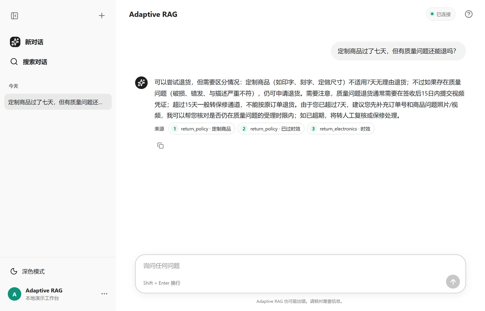
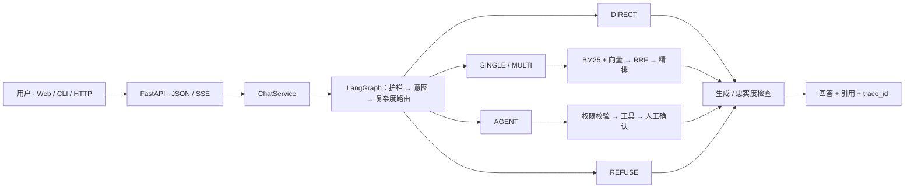

<h1 align="center">Self-RAG · 电商客服工作流</h1>

<p align="center"><strong>针对基于 FAQ 的传统客服系统长尾问题命中率极低，人工介入成本高的问题和常规 RAG 多跳推理能力差，幻觉问题严重的痛点设计并实现了基于 Self-RAG 的多智能体电商客服系统。</strong></p>
<p align="center">FastAPI × LangGraph × 混合检索 · API、流式对话与 ChatGPT 风格 Web 工作台</p>

<p align="center">
  <a href="https://github.com/jackliu1376/Self-rag/actions/workflows/ci.yml"></a>
  <a href="LICENSE"></a>
  
  
  

---
## 📷 项目快照
<p align="center">
  
</p>

<p align="center"><sub>Web 工作台：多条件退货提问，回答附带 <code>return_policy</code> 与 <code>return_electronics</code> 三条来源引用</sub></p>

<a id="why"></a>

## 🎯 和玩具 RAG 项目的区别

跑通一次问答只需要几十行代码，真实客服的差距从第二个问题开始出现：

| 维度 | 玩具版通常怎么做 | 本项目的做法 | 关键实现 |
|:---|:---|:---|:---|
| **路由** | 所有问题都走向量检索 | 五路分流，问候不检索，越权直接拒答 | [策略路由](app/retrieval/adaptive.py) |
| **召回** | 单路向量 top-k | BM25 + 稠密向量 + RRF 融合 + Cross-Encoder 精排 | [混合检索](app/retrieval/hybrid.py) |
| **多跳** | 一次检索定结果 | 改写与补检，最多 3 跳 | [Self-RAG](app/retrieval/self_rag.py) |
| **写操作** | 模型直接调用工具 | 参数校验、权限、待确认、幂等与审计 | [工具与权限](app/tools/) |
| **幻觉** | 生成后直接返回 | 引用绑定、忠实度检查、自纠错、证据不足拒答 | [忠实度](app/agents/nodes/faithfulness.py) |
| **依赖故障** | 任一依赖不可用即失败 | 分层降级，`/capabilities` 报告实际后端 | [容器装配](app/services/container.py) |
| **上下文** | 历史全量拼进 Prompt | 128k 预算与三级压缩 | [记忆](app/memory/) |
| **评测** | 手动试几句 | 3 套离线集与可复现的口径 | [评测](eval/MEASURED.md) |
| **工程化** | 本地脚本跑通即完成 | 双版本 CI 门禁、三档部署、健康检查与指标 | [CI](.github/workflows/ci.yml) · [部署](docs/11-deployment.md) |
| **边界** | 默认宣称可用 | 明确列出未完成项 | [使用边界](#limitations) |

前四行决定答得对不对，中间三行决定故障时能不能退，最后三行决定别人能不能接手和验证。

> [!TIP]
> 每个回答都带 `strategy`、`citations` 与 `trace_id`，降级后状态可查询，指标与复现命令都在仓库里；尚未完成的部分见[使用边界](#limitations)。

<a id="overview"></a>

## ✨ 一眼看懂

> **Self-RAG** 的核心决策是：这个问题需要直接回答、检索一条证据、交叉核对多条证据、调用业务工具，还是拒绝处理？

电商客服里的问题跨度很大。「你好」无需查知识库；退货政策需要可靠出处；「定制商品超过七天但有质量问题」要同时判断定制、时效与质量例外；取消订单则必须检查订单状态、权限与确认。项目用明确的路由策略处理这些差异，避免把所有输入都塞进同一条向量检索链路。

| 能力 | 你能看到什么 | 关键实现 |
|:---|:---|:---|
| **按复杂度路由** | 每次回答带有 `strategy`，便于追踪实际路径 | [Graph 与节点](app/agents/graph.py) · [策略枚举](app/core/enums.py) |
| **有出处的检索** | BM25、稠密向量、RRF 融合与精排；回答可带 `citations` | [检索模块](app/retrieval/) |
| **多跳与自纠错** | 复合问题拆分检索，答案经过忠实度检查 | [智能体节点](app/agents/nodes/) |
| **人工确认** | 高风险写操作先返回 `pending_action`，确认后才执行 | [工具与权限](app/tools/) |
| **Web 对话工作台** | 阶段进度、引用、本地会话搜索、深色模式与确认卡片 | [前端](frontend/) |
| **可测可观测** | 离线评测、回归测试、结构化日志与 Prometheus 指标 | [评测](eval/) · [可观测性](app/observability/) |

### 五条处理路径

| 策略 | 适合的问题 | 处理方式 |
|:---:|:---|:---|
| `DIRECT` | 问候、闲聊 | 直接生成，不做知识检索 |
| `SINGLE` | 单一政策问题 | 一轮混合检索与精排 |
| `MULTI` | 多条件、跨条款问题 | 查询改写、多路检索与自纠错 |
| `AGENT` | 查询订单、物流或发起业务操作 | 规划后调用受权限约束的工具 |
| `REFUSE` | 越权、注入或证据不足 | 拒答或引导人工处理 |

> [!TIP]
> 第一次了解项目，可以先看[架构图](#architecture)，再按[快速开始](#quickstart)提问。想看每条路径怎样落到代码，读[智能体与工具](docs/05-agents-and-tools.md)。

<a id="quickstart"></a>

## 🚀 快速开始

### 🐳 Docker 部署

需要 Docker Desktop，并确保 Docker Desktop 使用 WSL 2 后端。以下命令均在项目根目录执行。

#### 1. 默认演示

适合快速体验，使用 SQLite、BM25 和内存缓存 / 向量库，不需要 PostgreSQL、Redis、Qdrant 或外部 API 密钥。

```powershell
docker compose up --build -d
```

#### 2. 单机生产

使用 PostgreSQL、Redis 和单个 API 实例。先设置数据库密码：

```powershell
$env:POSTGRES_PASSWORD="your-password"
docker compose -f docker-compose.single.yml up --build -d
```

#### 3. 多实例生产

使用 PostgreSQL、Redis、Qdrant、两个 API 实例和 Nginx 负载均衡：

```powershell
$env:POSTGRES_PASSWORD="your-password"
docker compose -f docker-compose.multi.yml up --build -d
```

单机和多实例模式建议配置 `DEEPSEEK_API_KEY` 以启用生成式回答。启用本地 Embedding / Cross-Encoder 时，首次构建和启动可能下载模型，需要预留较大的磁盘和内存。

启动后访问 **http://127.0.0.1:8000**；API 文档见 **http://127.0.0.1:8000/docs**；健康检查见 **http://127.0.0.1:8000/api/v1/health**。

查看日志或停止服务：

```powershell
docker compose logs -f api
docker compose down
```

单机和多实例模式使用对应的 `-f` 参数执行 `logs` 和 `down`。没有 `DEEPSEEK_API_KEY` 时，系统使用离线证据回答；Redis、Qdrant、Embedding 或 Cross-Encoder 不可用时，会按代码中的降级策略继续运行。

不使用 Docker 时，需要 **Python 3.11+**；Web 开发另需满足[前端 Node.js 要求](frontend/README.md)。

### 1. 安装并启动 API

```bash
git clone https://github.com/jackliu1376/Self-rag.git
cd Self-rag
python3 -m venv .venv
source .venv/bin/activate
pip install -e ".[dev]"
cp .env.example .env
uvicorn app.asgi:app --reload --port 8002
```

Windows PowerShell 激活虚拟环境可使用 `.venv\Scripts\Activate.ps1`。首次启用本地 Embedding / Cross-Encoder 时可能需要下载模型；需要完整的本地精排依赖可安装 `pip install -e ".[rerank]"`。更多选项见[配置参考](docs/07-configuration.md)。

`.env` 中的 `DEEPSEEK_API_KEY` 可留空：此时系统进入离线演示模式，展示检索原文或可核对的订单状态，不会假装生成完整答案。要体验生成式回答，需要配置可用的 DeepSeek 密钥。**不要提交 `.env` 或密钥。**

### 2. 发送第一条消息

```bash
curl -s http://127.0.0.1:8002/api/v1/health
curl -s http://127.0.0.1:8002/api/v1/chat \
  -H 'content-type: application/json' \
  -d '{"message":"定制马克杯过了七天，但有质量问题还能退吗？","user_id":"u_demo"}'
```

响应包含 `answer`、`strategy`、`trace_id`，需要检索时还会带 `citations`。也可以运行 `python -m app.cli` 进入终端对话；流式接口为 `POST /api/v1/chat/stream`，完整字段见 [API 参考](docs/06-api-reference.md)。

### 3. 打开 Web 工作台

保持 API 运行，另开终端：

```bash
cd frontend
npm ci
npm run dev
```

访问 **http://127.0.0.1:5173**。开发服务器会把 `/api` 代理到本地 FastAPI。执行 `npm run build` 后，FastAPI 检测到 `frontend/dist` 也会在根路径提供页面；Docker 镜像会自动构建前端。前端会话列表存于浏览器本地，详见[前端 README](frontend/README.md)。

<details>
<summary><strong>🧪 想体验订单工具与人工确认？展开查看演示数据步骤</strong></summary>

<br>

当前分支默认启动**不会自动写入**演示订单。先停止 API，在仓库根目录、已激活虚拟环境的终端执行：

```bash
python - <<'PY'
import asyncio
from app.config.settings import get_settings
from app.services.container import build_container

async def main():
    container = await build_container(get_settings(), seed=True)
    await container.aclose()

asyncio.run(main())
PY
```

然后重新启动 API。种子会为 `u_demo` 写入 `ORD10001`（已发货）、`ORD10002`（已签收）和 `ORD10003`（已支付未发货）。例如询问“取消订单 ORD10003”，系统先给出 `pending_action.action_id`；确认请求携带该 ID 后才执行。详见 [HITL 与幂等](docs/05-agents-and-tools.md)。

</details>

<a id="architecture"></a>

## 🏗️ 系统架构



HTTP 层处理校验与序列化，`ChatService` 编排对话，Graph 决定路径，检索器与工具由容器装配。默认数据库为 SQLite；Redis、Qdrant 和远程模型按配置接入。完整的节点、降级路径和依赖关系见[架构与运行流程](docs/17-architecture-flow.md)。

<a id="evaluation"></a>

## 📊 实测结果与口径

下面的**检索与生成指标**来自 2026-11-19 的离线评测（`cn:deepseek-v4.1-flash` + 本地 bge-small / Cross-Encoder），具体数据集、模型与运行命令见 [`eval/MEASURED.md`](eval/MEASURED.md) 和[完整报告](docs/14-evaluation-report.md)。报告原始 JSON 未随仓库分发，复现时应以当前环境重新运行。

| 环节 | 样本与设置 | 结果 |
|:---|:---|:---|
| 意图识别 | 100 条训练 + 43 条留出 | 训练集 **100%** · 留出集 **95.3%**；纯模型结果并非 100% |
| BM25 稀疏检索 | 65 条政策问题 / 39 篇文档 | P@1 **80.0%** · R@3 **90.0%** |
| bge-small 稠密检索 | 同一检索集 | P@1 **81.5%** · R@3 **94.6%** |
| Hybrid + Cross-Encoder | 同一检索集 | P@1 **89.2%** · R@3 **96.2%** · MRR **0.93** |
| RAG + 自纠错生成 | 65 条，同模型 + 独立裁判 | 同模型 **100% / 0%**；独立裁判 **89.2% / 10.8%**；一致率 84.6% |
| 多跳检索 | 20 条，每条 ≥2 篇相关文档 | Hybrid+CE **R@5 80.8%** · Hit@3 **100%** · RAG 关键词 **95%** |
| 端到端 | 16 条 | 关键词命中 **11/11** · P50 **8.08s** · P95 **9.21s** |

> [!IMPORTANT]
> 这些是**指定离线集合与模型配置**下的测量值，不代表生产环境承诺。意图训练集 100% 不等于泛化 100%：43 条没参与调参的留出集是 95.3%。本轮 RRF 只比单独使用 bge-small 略高，主要增益来自 Cross-Encoder；生成忠实度有同模型与独立模型（`cn:glm-5.3`）两套裁判，RAG 答案一致率 84.6%，同模型的 100%/0% 偏乐观，对外请同时报独立裁判的 89.2%/10.8%。多跳 20 条虽然 Hit@3 100%，但多文档覆盖 R@5 只有 80.8%，不要把"至少命中一篇"写成"跨条款全覆盖"。不要把同模型裁判的 `0%` 幻觉率理解为真实场景零错误；无检索 Faithfulness 随裁判模型变化，不能跨模型比较。两套裁判都不是人工标注。

CI 在 Python 3.11 / 3.12 上检查锁文件、Ruff、mypy 和 pytest；[查看工作流](.github/workflows/ci.yml)。本地可运行：

```bash
python -m pytest -q
python -m eval.runner --task retrieval
cd frontend && npm test && npm run build
```

<a id="docs"></a>

## 🗺️ 从哪里继续阅读

| 目标 | 推荐入口 |
|:---|:---|
| 跑通 API、CLI、Web 与 Docker | [快速开始](docs/02-getting-started.md) · [部署](docs/11-deployment.md) |
| 理解分层、Graph 与路由 | [架构](docs/03-architecture.md) · [Self-RAG](docs/04-adaptive-rag.md) |
| 看检索、精排、工具与 HITL | [解析与检索](docs/15-ingest-and-retrieval.md) · [智能体与工具](docs/05-agents-and-tools.md) |
| 查接口、配置、安全与可靠性 | [API](docs/06-api-reference.md) · [配置](docs/07-configuration.md) · [安全](docs/09-security.md) · [可靠性](docs/08-reliability.md) |
| 核对实验口径与数字 | [评测方法](docs/10-evaluation.md) · [原始数字说明](eval/MEASURED.md) |
| 系统学习 RAG 工程实践 | [12 部分教学文档](docs/tutorial/README.md) |
| 准备 Agent/RAG 面试 | [Chapter 1](docs/interview/chapter1.md) · [Chapter 2](docs/interview/chapter2.md) · [Chapter 3](docs/interview/chapter3.md) · [17 维度索引](docs/16-interview-bagu-map.md) |

完整索引见 [`docs/README.md`](docs/README.md)。源码可从 `app/asgi.py` → `app/services/chat_service.py` → `app/agents/graph.py` 开始读；Web 代码在 `frontend/src/`。

<details>
<summary><strong>📁 展开项目目录</strong></summary>

```text
app/
  api/            HTTP 路由、校验、SSE
  services/       ChatService、依赖容器、演示数据
  agents/         LangGraph 状态机与节点
  retrieval/      解析、切块、混合检索、精排与自纠错
  tools/          业务工具、注册表与权限
  repositories/   订单、会话与幂等
  providers/      生成、Embedding 与 Rerank
  guardrails/     注入、边界与忠实度检查
  memory/         上下文预算与压缩
  observability/  日志、指标与请求上下文
frontend/         React + TypeScript Web 工作台
knowledge/        政策文档
eval/             离线评测与口径
tests/            单元、集成与端到端测试
docs/             技术手册与教学文档
```

</details>

<a id="limitations"></a>

## ⚠️ 使用边界

这是可运行的工程示例，**目前不应直接面向不可信用户开放**：

- API 尚未认证请求中的 `user_id`；前端默认 `u_demo` 仅供本地演示。部署前应由可信服务端认证并绑定身份。
- 订单与物流来自本地仓储演示数据，没有连接真实承运商或支付网关。
- Web 会话列表保存在当前浏览器的 `localStorage`，清除站点数据或换设备后不会恢复。
- 知识库启动时全量 ingest，尚无增量删除接口；Embedding / 精排权重不可用时会降级，降级后的效果未单独评测。

更多实现边界与后续方向见[限制与路线图](docs/12-limitations.md)。

<a id="roadmap"></a>

## 🧭 后续完善与优化路线图

下面先列出已经落地的优化，再列出尚待推进的工作。路线仍按身份、会话和写操作正确性、知识库更新、响应速度与云端演示体验排序。

### 已完成的优化

| 状态 | 已完成项 | 结果与入口 |
|:---:|:---|:---|
| ✅ | **三档 Docker 部署** | 默认 SQLite + BM25 演示、PostgreSQL + Redis 单机、PostgreSQL + Redis + Qdrant 多实例模式。[Compose 文件](docker-compose.yml) · [部署说明](docs/11-deployment.md) |
| ✅ | **本地开发启动脚本** | PowerShell 一键启动 API 与 Vite 前端，默认使用 8002 / 5173，也支持自定义端口。[启动脚本](scripts/dev-start.ps1) |
| ✅ | **运行状态与能力探测** | 增加 liveness、readiness 和 capabilities 接口，报告数据库、缓存、向量库、检索、精排和 LLM 实际后端。[健康检查](app/api/routes/health.py) |
| ✅ | **降级路径可见化** | Redis、向量库、Embedding、精排和生成模型不可用时继续运行，并记录启动时实际运行模式。[容器装配](app/services/container.py) |
| ✅ | **跨平台文档 ID 稳定** | 文档 ID 改为基于知识库相对路径生成，避免 Windows、Linux 与 Docker 因绝对路径不同产生重复向量。[切块](app/retrieval/chunking.py) |
| ✅ | **前端连接错误提示** | API 未启动或请求失败时显示用户可理解的中文提示，隐藏内部错误文本；前端 API 地址支持 `VITE_API_BASE`。[前端请求](frontend/src/lib/api.ts) |
| ✅ | **工程质量门禁** | CI 已覆盖 Python 3.11 / 3.12 的 Ruff、mypy、pytest 和覆盖率检查；前端构建已验证。[CI](.github/workflows/ci.yml) |

### 1. 上线前先补齐

| 优先级 | 改进项 | 目标与代码入口 |
|:---:|:---|:---|
| P0 | ✅ **身份认证** | 支持 `AUTH_MODE=trusted_header`：只信任网关注入的 `X-User-Id`（缺失 401），并保留会话归属校验；生产需网关认证并剥离客户端同名 header。[身份解析](app/api/auth.py) · [会话仓储](app/repositories/session_repository.py) |
| P0 | ✅ **云端部署边界** | 数据库、Redis、Qdrant 均无 host 端口映射，密码必须由 `POSTGRES_PASSWORD` 提供；只开放受控的 Web/API 入口。[Compose](docker-compose.yml) |
| P0 | ✅ **真正接入多轮记忆** | 会话摘要从 DB 加载，最近历史与摘要按字符预算送入生成、路由、规划与检索；短追问会带上上一轮用户问题，压缩仍在回答后执行。[记忆上下文](app/memory/context.py) · [对话服务](app/services/chat_service.py) |
| P1 | ✅ **可靠的人工确认** | 待确认操作已落 DB，支持过期、幂等防重和多副本。[待确认仓储](app/repositories/pending_actions.py) · [对话服务](app/services/chat_service.py) |
| P1 | ✅ **准确呈现服务状态** | 区分 API 存活与模型、向量库就绪；Embedding 或精排降级时在 `/capabilities` 与前端 pill 明确提示。[健康检查](app/api/routes/health.py) · [模型装配](app/services/container.py) |

### 2. 提升功能与体验

| 方向 | 改进项 | 预期效果 |
|:---|:---|:---|
| 知识库 | 增量入库、删除同步、文档版本与缓存失效；避免旧向量和旧引用残留。[入库](app/retrieval/ingest.py) · [向量库](app/retrieval/vector.py) | 政策更新后，检索结果与引用保持一致。 |
| 文档解析 | 在需要 PDF、Office、图片入库的镜像中安装解析依赖与系统包，并报告解析失败的文件。[解析器](app/retrieval/unstructured_parser.py) · [Dockerfile](Dockerfile) | 非 Markdown 文档不再被静默跳过。 |
| 响应体验 | 明确显示检索、生成、核验进度；当前 SSE 在答案核验完成后才分块输出。[SSE](app/services/chat_service.py) · [前端请求](frontend/src/lib/api.ts) | 用户能看懂等待发生在哪一步。 |
| 速度与成本 | 记录每个节点的耗时、调用次数和 Token 用量，为简单问题设置快速路径，为多跳检索设置预算。[工作流](app/agents/graph.py) · [指标](app/observability/metrics.py) | 减少不必要的模型调用。 |
| 首次演示 | 让首页示例问题与演示订单初始化保持一致，并提供一键准备演示数据的入口。[首页](frontend/src/App.tsx) · [种子数据](app/services/seed.py) | 打开页面即可验证订单与确认流程。 |
| 模型启动 | 预热本地 Embedding 与精排模型，持久化权重缓存，显示加载或降级状态。[Embedding](app/providers/embeddings.py) · [精排](app/providers/reranker.py) | 减少首问等待和重建后的重复下载。 |
| 前端会话 | 将仅存于 `localStorage` 的会话与服务端历史打通，并增加断线重连状态。[本地存储](frontend/src/lib/storage.ts) | 刷新、换设备后仍可继续对话。 |

### 3. 工程化与复杂改造

1. **数据库迁移：** 启动时使用 `create_all`，应改为部署时运行 Alembic，并验证升级和回滚。[数据库初始化](app/repositories/db.py)
2. **完整回归链路：** 在现有 Python CI 上补充前端测试、Docker 构建，以及覆盖问答、引用、订单查询、人工确认的端到端测试。[CI](.github/workflows/ci.yml)
3. **通用 MCP 与真实业务接入：** 当前远程工具通过固定 HTTP JSON 接口调用；若要对接通用 MCP 服务或真实订单、物流系统，还需处理能力发现、认证、权限、超时和审计。[MCP 适配器](app/mcp/runtime.py) · [业务工具](app/tools/)
4. **一致性设计：** 多轮摘要不能覆盖最新事实；写操作确认时要重新核对订单状态；知识库更新时 BM25、向量、缓存和引用应切到同一版本。这三处适合分别做设计和故障测试。

## 🤝 参与贡献

欢迎提交问题与改进。修改前建议先读[贡献指南](CONTRIBUTING.md)；提交代码时运行 Ruff、mypy、pytest，修改前端时运行 `npm test` 与 `npm run build`。请勿提交 `.env`、密钥、本地数据库或生成的评测报告。

## 📄 许可证

项目采用 [MIT License](LICENSE)。可在保留许可与版权声明的前提下使用、修改和分发。

---

<p align="center">
  <sub>从一个问题开始，沿着策略、证据、工具与指标追到代码。<br>
  指标口径以 <a href="eval/MEASURED.md">eval/MEASURED.md</a> 为准。</sub>
</p>
